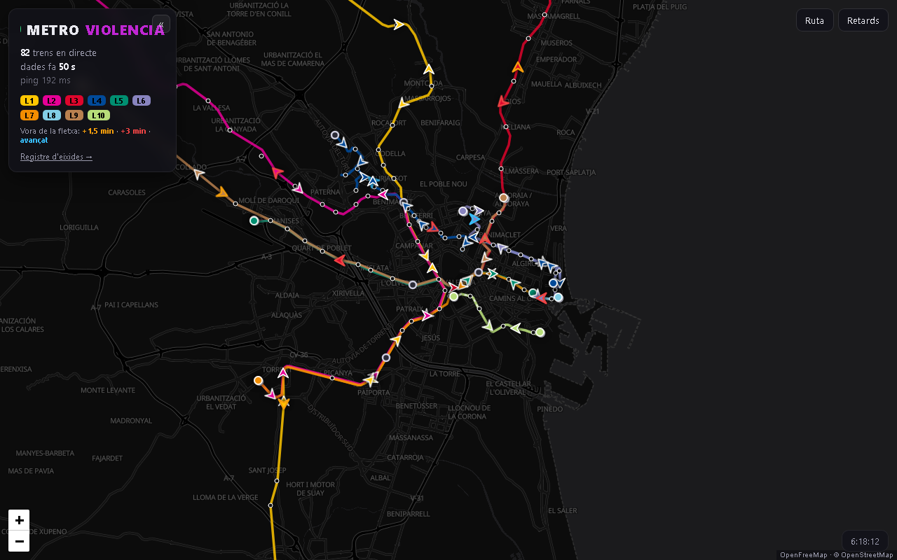

# Metroviolencia

Visualización en **tiempo real** de los trenes de Metrovalencia sobre un mapa
de la red, con horario programado frente a real: salidas canceladas, retrasos
en ruta y calculadora de rutas con los trenes en vivo que hay que coger.



## Cómo funciona

1. **Fuente de datos.** La web pública de Metrovalencia consulta, por estación,
   un endpoint AJAX de WordPress (`admin-ajax.php`, acción `info-estacion`)
   que devuelve un fragmento HTML con las próximas llegadas: línea + destino +
   ETA con resolución de minuto (`backend/parser.py`). A partir de 1 h la web
   solo da "1 h", "2 h": esos valores se ignoran para casar trenes. Desde
   septiembre de 2026 los tranvías (L4/L6/L8/L10) también dan datos, aunque
   sus ETAs son de horario, no de posición real. El horario programado sale
   del planificador oficial (formulario `horarios-ruta`).

2. **Geometría.** `scripts/extract_network.py` saca de `/ca/consulta-mapes/`
   (variable JS `datosMapaGeneral`) las 144 estaciones, trazados de metro y
   colores oficiales → `data/network.json`. Los trazados de tranvía vienen de
   OpenStreetMap (`data/tram_tracks.json`, ver Herramientas).
   `backend/network.py` proyecta cada estación sobre la vía de su línea
   comercial y convierte distancia-sobre-la-vía <-> lat/lng.
   `data/service.json` añade cierres de tramo con fecha de caducidad
   (`hasta`), estaciones de retorno intermedias y tramos subterráneos.

3. **Poller** (`backend/poller.py`). Cada **60 s** sondea las 144 estaciones
   con 12 hilos en paralelo (~6 s por barrido) y guarda en SQLite
   (`data/metro.db`): `snapshots`, `arrivals` (llegadas crudas), `noinfo`
   (líneas que no dieron ningún dato en la pasada) y `lecturas_fallidas`
   (estación no leída o cabecera con panel vacío). Una vez por hora lanza en
   segundo plano la descarga del horario de hoy y mañana y, una vez al día,
   la purga. TLS: `data/ca-bundle.pem` si existe, si no `truststore`.
   **Fuera del horario de servicio** (ninguna hora de paso programada a
   menos de 20 min) pasa a *modo noche*: una pasada centinela cada 10 min;
   si la centinela ve trenes (servicio especial, horario incompleto) vuelve
   a la cadencia normal durante 30 min. Sin horario descargado no se aplica.

4. **Estimador + tracking.** `backend/positions.py` reconstruye trenes
   **físicos**: para cada (línea, destino) recorre las estaciones en orden de
   ruta; mientras las ETAs crecen es el mismo tren, una caída brusca (>45 s)
   marca otro tren por delante. Cada tren emite `waypoints` `[{d, eta, nom}]`
   (distancia sobre la vía y segundos hasta cada parada); su posición actual
   se interpola entre la estación anterior y la próxima con el tiempo de tramo
   (mediana de las diferencias de ETA entre vecinas). Los que esperan en
   cabecera van marcados `origen`. Dos trenes del mismo destino a <130 m se
   colapsan (artefacto de terminal). `backend/tracking.py` da a cada tren un
   `track_id` **persistente** entre pasadas: predice dónde estaría cada tren
   anterior tras Δt y lo empareja con el actual más próximo del mismo
   (línea, destino) respetando el orden a lo largo de la ruta (alineamiento
   por programación dinámica). Resultado en la tabla `trenes`.

5. **Horario y registro de salidas.** `backend/cabeceras.py` fija las 15
   cabeceras donde todo tren listado es una salida (las intermedias como
   València Sud o Empalme mezclan salidas y pasos y no se registran).
   `backend/horarios.py` descarga del planificador el horario de cada
   cabecera contra cada destino que sale de ella y atribuye cada hora al
   destino más específico → `horario_prog`. `backend/calendario.py` da el
   tipo de día (color blau/verd/roig, anyil en tranvía, y `+nocturn`) desde
   `data/calendario_AÑO.json`. `backend/salidas.py` sigue cada tren listado en
   cabecera hasta que sale (`salidas_obs`: `en_espera`, `salida`,
   `desaparecida`, `sin_datos`) y cruza programado con real: cada salida
   programada queda *realizada* (con retraso), *prevista*, *cancelada*,
   *pendiente* o *sin_datos*, más las *no_programada*. Se consulta en
   `web/registre.html`, `/api/registro` o `python -m backend.salidas --dia`.

6. **Retrasos en ruta y en vivo** (`backend/pasos.py`). El horario de paso
   por estación (`horario_paso`) se obtiene consultando cada estación con su
   vecina en cada sentido (290 pares, ~7 min por día). Mismo tipo de día =
   mismo horario: cada día cuyo horario es idéntico a uno ya guardado solo
   apunta a él (`horario_paso_rep`) y las horas se recalculan para el día
   pedido, a prueba de cambio de hora (86 días ocupaban 2,0 M filas; 27
   representantes, 0,6 M). El mismo seguimiento
   de las cabeceras se aplica a **todas** las estaciones (`pasos_obs`) y cada
   paso real se casa con la hora programada más cercana (<15 min). En troncos
   compartidos, donde otra hora está casi igual de cerca, el paso se descarta
   en vez de inventar un retraso; las paradas cuyo retraso mediano se aparta
   más de 150 s de sus contiguas se consideran horario incoherente y se
   excluyen. `retraso_vivo` aplica lo mismo a los waypoints de cada tren en
   vivo: es el retraso que enseña el mapa al tocar un tren y el color del
   borde de la flecha (+1,5 min ámbar, +3 min rojo, adelantado azul).

7. **Calculadora de rutas** (`backend/rutas.py`). Pide al planificador las
   alternativas origen -> destino (ventana de 2 h; si no hay tren, resto del
   día; si tampoco, mañana), deduce la línea de cada paso y le asigna los
   trenes en vivo que sirven (mismo sentido, aún no han pasado por la
   estación de subida, destino igual o más allá de la de bajada), con su
   desfase frente a la salida programada y las salidas programadas de los
   próximos 30 min sin tren anunciado (posible cancelación).

8. **API + frontend.** `backend/api.py` (FastAPI) sirve la API y `web/` como
   estático. `web/app.js` (Leaflet + MapLibre GL con teselas de OpenFreeMap;
   raster OSM si no hay WebGL) pide `/api/trains` cada 60 s e interpola las
   posiciones con el reloj corrigiendo latencia y desfase de reloj con el
   servidor; los tranvías cuyo `d` no cambia entre pasadas se congelan para no
   avanzar y recular. `web/panells.js` añade los paneles **Ruta** y
   **Retards** (van tarde, cancelados, todos, en ruta).

## Endpoints de la API

| Ruta | Parámetros | Devuelve |
|---|---|---|
| `GET /api/network` | – | Geometría estática: estaciones, líneas comerciales con `path`/`cum`, colores, cierres vigentes, subterráneos, estaciones de retorno, trazados de tranvía |
| `GET /api/trains` | – | Trenes de la última pasada: `id` (track), línea, destino, posición, `prox_estacion`, `eta_seg`, `origen`, `waypoints`, `retraso`; más `ts`, `edad_seg`, `srv_ms`, `noinfo` |
| `GET /api/arrivals` | – | Llegadas crudas del último snapshot agrupadas por estación |
| `GET /api/ruta` | `origen`, `destino` (ids) | `dia`, `ventana` (`2h`/`hoy`/`manana`) y alternativas con pasos, líneas, trenes en vivo (`eta_subida`, `desfase_s`, `hora_prog`), `proxima_prog`, `sin_tren` |
| `GET /api/retards_ruta` | `dia` (YYYY-MM-DD, hoy por defecto) | Retrasos en ruta: resumen por línea de la última hora y del día (`n`, `mediana_s`, `tarde`) y `tarde_recientes` (pasos a >=3 min en los últimos 45 min) |
| `GET /api/registro` | `dia` | Salidas programadas vs reales de las cabeceras: `tipo_dia`, `resumen` por estado y retraso mediano/medio, y una fila por salida |
| `GET /api/health` | – | `snapshots` acumulados y `ultimo_ts` |

Acceso: dentro de la red local (RFC 1918 / loopback) no hace falta token.
Desde fuera el middleware exige un token (`data/token.txt` o `METRO_TOKEN`)
que se pasa una vez como `?token=` y queda en cookie; sin él responde 403.
`data/open_until.txt` abre una ventana temporal sin token (un instante Unix; o
la palabra `siempre`, que no caduca). **Desde el 05/10/2026 Raspa lo tiene en
`siempre`: el token está levantado y la web es pública**; para volver a exigirlo
basta borrar ese fichero (el token de `data/token.txt` sigue vigente y la APK
personal lo sigue mandando, sin efecto). Todas las respuestas van con
`Cache-Control: no-store`.

## Uso local

```bash
python -m venv .venv
.venv/Scripts/pip install -r requirements.txt        # Linux: .venv/bin/pip
python scripts/build_ca_bundle.py                    # una vez (Linux/OpenSSL)

python -m backend.poller                             # sondeo continuo
python -m uvicorn backend.api:app --host 0.0.0.0 --port 8770   # otra terminal
# -> http://localhost:8770
```

Una sola pasada: `python -m backend.poller --once`. Horario a mano:
`python -m backend.horarios --dia YYYY-MM-DD` (cabeceras) y
`python -m backend.pasos --horario --dia YYYY-MM-DD` (paso por estación).
Resúmenes: `python -m backend.salidas --dia` y `python -m backend.pasos --dia`.
Ambos admiten `--reprocesar YYYY-MM-DD` para rehacer el seguimiento desde
`arrivals` (con el poller parado).

Tests (offline, ~8 s; pasarlos antes de desplegar):

```bash
.venv/Scripts/pip install pytest httpx
.venv/Scripts/python -m pytest tests -q
```

Cubren parser, geometría, estimador + tracking (con una hora real del 29/09
como regresión), casamiento de retrasos, planificador de rutas y la API con
su control de acceso. El único `xfail` documenta que en datos reales hasta un
10 % de los trenes retroceden unos metros entre pasadas (ruido de minuto).

## Despliegue en Raspa

`deploy/` tiene dos servicios systemd y la configuración de Apache:

- `metroviolencia-poller.service`: `python -m backend.poller --interval 60`.
- `metroviolencia-web.service`: uvicorn en `127.0.0.1:8770` con
  `--root-path /metroviolencia`; nunca expuesto directamente.
- `apache-metroviolencia.conf`: proxy inverso `/metroviolencia/` -> `:8770`
  (ruta heredada, ver más abajo). En 80, 443, 5580 y 8751 queda abierto y es el
  token de la API quien cierra el paso desde fuera de la LAN.
- `metroviolencia.pr1.es.conf` / `metroviolencia.pr1.es-ssl.conf`: el vhost del
  subdominio propio (ver más abajo).

Acceso en la LAN: `http://192.168.1.100/metroviolencia/`. Fuera de la LAN,
con token.

### Subdominio propio: `https://metroviolencia.pr1.es/`

Desde el 05/10/2026 la aplicación cuelga también de la **raíz** de su propio
nombre. Es la dirección que hay que dar a quien la use; la ruta
`/metroviolencia/` queda como herencia (ver más abajo). El acceso lo decide la
aplicación, no Apache (hoy sin token, ver «Acceso» arriba).

- **DNS**: registro A `metroviolencia` en la zona `pr1.es` (TTL 60) que mantiene
  el DDNS de Raspa (`~/ddns_ovh/ddns_ovh.py`, lista `REGISTROS`): si la IP
  pública cambia, se reescribe solo. El DDNS **no crea** registros; si se borra,
  se da de alta a mano con la API de OVH (`POST /domain/zone/pr1.es/record`,
  `fieldType=A`, `subDomain=metroviolencia`, `ttl=60`, y `POST .../refresh`).
- **Apache** (`sites-available/` + `a2ensite`): `metroviolencia.pr1.es.conf`
  (:80, sirve el reto ACME y redirige a HTTPS) y `metroviolencia.pr1.es-ssl.conf`
  (:443, proxy de `/` a `127.0.0.1:8770`). El `/api/` hay que ganarlo con un
  `<Location /api/>` propio dentro del vhost: `director-ocr.conf` declara uno
  global que, si no, se lleva el `/api` de todos los sitios a la API OCR del
  Director.
- **Certificado**: Let's Encrypt (ECDSA, webroot `/var/www/metroviolencia.pr1.es`,
  renovación por `certbot.timer`). Con el vhost :80 ya activo:
  `sudo certbot certonly --webroot -w /var/www/metroviolencia.pr1.es -d metroviolencia.pr1.es --key-type ecdsa`
- **Cookie del token** (solo si se vuelve a exigir token): aquí la app cuelga de la raíz, no de `/metroviolencia`,
  así que el vhost manda `X-Forwarded-Prefix: /` y `X-Forwarded-Proto: https` y
  `backend/api.py` fija la cookie con `Path=/` y `Secure` (en la ruta heredada
  sigue con `Path=/metroviolencia`). Hay prueba en `tests/test_api.py`.

### Ruta heredada: se mantiene hasta el 05/10/2027

`http://home.pr1.es:5580/metroviolencia/` sigue atendida durante un año a partir
del 05/10/2026, porque la APK personal lleva esa dirección embebida. Estado real
medido desde fuera de la LAN el 05/10/2026:

- **`:5580` funciona, pero por redirección**: el router manda el 5580 al :80 de
  Raspa, y desde que `home.pr1.es` es el KDS (22/09/2026) su vhost :80 redirige
  todo a `https://home.pr1.es/metroviolencia/`, que sí sirve el mapa (proxy
  global de `apache-metroviolencia.conf`, abierto en el 443). Un cliente que no
  siga redirecciones (o que no admita HTTPS) no llega.
- **`https://home.pr1.es:8751/` NO llega desde fuera** (el router no lo
  reenvía); solo valdría en la LAN.

Reconstruir la APK necesita el token (solo está en Raspa, `data/token.txt`).
Para que use el subdominio: `BASE_EXT_HTTPS=https://metroviolencia.pr1.es/
apk/build_apk.sh` (el certificado de Let's Encrypt es de confianza: no hace
falta empaquetar ninguno). Está pendiente.

Pasada esa fecha: decidir si se retira el proxy `/metroviolencia/` de
`deploy/apache-metroviolencia.conf` (ojo: también es la ruta de la LAN,
`http://192.168.1.100/metroviolencia/`) y el `Listen 8751`, comprobando antes
que nadie la sigue pidiendo en `/var/log/apache2/home.pr1.es-access.log`,
`home.pr1.es-ssl-access.log` y `other_vhosts_access.log`.

Una vez, con ambos servicios parados: `python -m backend.purga --vacuum`
activa `auto_vacuum=INCREMENTAL` y compacta la base (el temporal del VACUUM
va a `data/tmp/`, no a `/tmp`, que es RAM). Desde entonces el poller purga a
diario: `arrivals` se conserva 14 días, `trenes` 3 y `pasos_obs` 30 (antes de
borrar un día se guarda su resumen de retrasos por línea y por parada en
`retards_dia` / `retards_estacio`, que es lo que `/api/retards_ruta` sirve
para esos días, con `resumido: true`); `snapshots`, horarios, `salidas_obs`,
`lecturas_fallidas` y `noinfo` se guardan siempre. Al pasar a horario por
tipo de día en una base anterior: `python -m backend.pasos --dedupe` (con el
poller en marcha vale).

## Herramientas

- `scripts/extract_network.py`: geometría de la red desde el HTML de mapas
  (guardado en `data/consulta-mapes.raw.html`) → `data/network.json`.
- `scripts/fetch_tram_tracks.py`: trazado real de L4/L6/L8/L10 desde OSM
  (Overpass, un sentido por línea) → `data/tram_tracks.json`.
  `scripts/collapse_tram_tracks.py` colapsa los raíles paralelos a una línea
  central conservando ramales (respaldo en `tram_tracks.raw.json`).
  `scripts/fetch_tram_extra.py` baja el sentido contrario y se queda solo con
  los tramos que van por otra calle (playa) → `tram_tracks_extra.json`, solo
  para dibujar.
- `scripts/extract_calendario.py [AÑO]`: lee los PDF del calendario de
  circulación (color de cada número con `pdftotext -bbox` + `pdftoppm`) →
  `data/calendario_AÑO.json`. Requiere poppler-utils y Pillow.
- `scripts/build_ca_bundle.py`: certifi + el intermedio de Sectigo que
  metrovalencia.es no envía → `data/ca-bundle.pem`.
- `python -m backend.backfill [--fase A|B|C|D|todo] [--desde 2026-07-08]`:
  relleno del registro hacia atrás con el histórico (`data/archivo/*.csv.gz`
  y lo que quede en `arrivals`). Fases reanudables: A reproduce las pasadas
  en una base temporal (`data/tmp/backfill.db`), B descarga el horario de
  cabecera de cada fecha con los destinos que circulaban esa semana, C el
  horario de paso (un día por tipo de calendario, reutilizado si el horario
  de cabecera coincide), D copia a `metro.db` lo anterior a lo que ya
  registraba el poller.
- `python -m backend.purga [--vacuum]`: purga manual (ver Despliegue).
- `apk/build_apk.sh [TOKEN]`: APK WebView que prueba en orden la URL de la
  LAN y las externas. Variante personal (token embebido) o `--dist` (la app
  pide el token la primera vez y lo guarda). Usa el JDK y el SDK de Android de
  `.tools` del directorio padre (o `TOOLS`); `BASE_LAN`, `BASE_EXT_HTTPS` y `BASE_EXT_HTTP` se
  pueden sobreescribir por entorno.

## Aviso

Datos obtenidos de la web pública de Metrovalencia con fines no comerciales.
Las posiciones son **estimaciones** a partir de los tiempos de llegada, no
telemetría real; en los tranvías las ETAs de la fuente son de horario. Los
retrasos tienen resolución de minuto y las cabeceras intermedias no se
registran.
